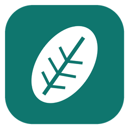

# Leaf Notes

A notetaking app for Linux, Windows and Android, built for students: write with a pen or type, mix in maths, pictures and recordings, and study from flashcards. Everything works offline; AI and sync are optional.



## What it does

- **Notebooks › sections › pages**, with subpages, favourites, recent pages, page links (`[[Page name]]`) and backlinks, tags, a task list across all notes, search, and a quick switcher (Ctrl+K).
- **Free-form pages**: click anywhere to type. Notes can be text with Markdown-style formatting, checklists, tables, code, LaTeX equations, pictures, files and links. Type `/` for the insert menu.
- **Pen and ink**: pen, pencil, highlighter, eraser, lasso, and shapes that snap into place. Supports pressure and smoothing; scribble over ink to erase it. Choose a background: plain, ruled, grid, dots, Cornell or music staves.
- **Made for touch too**: phone and tablet layouts, palm rejection while the stylus writes, two-finger tap to undo (three to redo), pinch to zoom, and photos straight from the camera on Android.
- **Handwriting to text and to LaTeX**, offline (a small built-in recognizer), or with your AI if you prefer.
- **PDF printouts**: put a PDF's pages on a page and write on them, then export as a PDF with your notes on top.
- **Audio recording linked to notes**: tap something you wrote to hear what was being said at that moment; play back at 0.75× to 2×.
- **Flashcard decks** as their own page type, with spaced repetition. Make a deck by hand, from your notes, or with AI.
- **AI with your own key** (Anthropic, or any OpenAI-compatible server, including local ones): chat about a page, summarise, rewrite, make cards.
- **Sync** through Google Drive, a synced folder (Dropbox, OneDrive, Syncthing…) or a WebDAV server (Nextcloud…). Changes merge note by note; a page changed on two devices at once is kept in both versions.

## Download

Every push to `main` builds three files under **Actions ▸ Build ▸ Artifacts**:

| Platform | File |
|---|---|
| Linux | `LeafNotes-<version>-x86_64.AppImage`: make it executable (`chmod +x`) and run it |
| Windows | `LeafNotes-<version>-x86_64.msi`: installer |
| Android (arm64) | `LeafNotes-<version>-arm64.apk`: allow installing from this source |

Push a version tag (`git tag v0.1.0 && git push --tags`) to publish the three files as a GitHub release. Its description comes from that version's section in [CHANGELOG.md](CHANGELOG.md), so add the section first (the release stops if it's missing).

## Build from source

You need [Rust](https://rustup.rs). On Linux, also the ALSA headers (`libasound2-dev` / `alsa-lib-devel`).

```sh
cargo run --release
cargo test --release
cargo run --release -- --screenshot shot.png   # renders a preview picture and exits
```

Android (needs the Android SDK, NDK 27 and `cargo install cargo-apk`):

```sh
rustup target add aarch64-linux-android
export ANDROID_HOME=~/Android/Sdk ANDROID_NDK_ROOT=~/Android/Sdk/ndk/27.1.12297006
cargo apk build --release --lib
sh tools/android-java.sh target/release/apk/LeafNotes.apk   # adds the small Java part (file picker, sharing, key store)
```

## Credentials (not in the repository)

| What | Locally | In GitHub Actions (repository secret) |
|---|---|---|
| Google Drive sign-in: the client secret of the Desktop OAuth client | `.cargo/config.toml` → `[env] LEAFNOTES_GOOGLE_SECRET = "…"` | `LEAFNOTES_GOOGLE_SECRET` |
| Android signing key | `android/dev.keystore` (password in `Cargo.toml`) | `ANDROID_KEYSTORE_B64`: the keystore, base64-encoded |
| Windows code signing (optional) | — | `WINDOWS_CERT_PFX_B64` (the .pfx certificate, base64) and `WINDOWS_CERT_PASSWORD` |

Without the Google secret, the app builds fine but its Google Drive option says it isn't set up. Without the keystore secret, CI signs the APK with a throwaway key, so it can't update a copy signed with your own key.

```sh
gh secret set LEAFNOTES_GOOGLE_SECRET            # paste the GOCSPX-… value
base64 -w0 android/dev.keystore | gh secret set ANDROID_KEYSTORE_B64
```

The Android key in `android/dev.keystore` is a development key. Before a store release, make your own (`keytool -genkeypair -keystore release.keystore -alias leafnotes -keyalg RSA -keysize 4096 -validity 10000`), keep it safe, and use it for `ANDROID_KEYSTORE_B64` (and the password in `Cargo.toml`). With a Windows code-signing certificate in the two secrets above, CI signs the program and the installer, so Windows no longer warns about an unknown publisher.

For Google Drive, the Google Cloud project also needs the **Google Drive API** turned on. While its consent screen is in "Testing", Google ends sign-ins after 7 days; publish the app (the `drive.file` scope needs no review) to avoid that.

## Where your notes live

- Linux: `~/.local/share/LeafNotes`
- Windows: `%APPDATA%\LeafNotes`
- Android: the app's private storage

- Anywhere else: set `LEAFNOTES_DATA=/some/folder` (portable use)

- `library.json`: notebooks, sections, page titles and Recently deleted (with a `.backup` from before each session)
- `pages/`: one file per page, rewritten only when that page changes
- `history/`: earlier versions of each page (⋯ ▸ Page history)
- `files/`: pictures, PDFs and recordings
- `search-index.json`: text read from handwriting and PDFs, for search (rebuilt when missing)

Every file is written safely (a temporary file, then a rename), and a damaged file costs one page, never everything. Older versions stored everything in `notebooks.json`; it is split up on the first start and kept as `notebooks.json.before-split`. Settings ▸ Your data saves and restores backups. The pages of locked sections are stored, synced and backed up only in encrypted form; pictures, PDFs and recordings on them are not encrypted.

Your AI key, WebDAV password and Google sign-in are kept in the system keyring: Windows Credential Manager, or the Secret Service on Linux (GNOME Keyring, KWallet). The settings files keep an empty field. On Android they are encrypted with a key held by Android's key store. If no keyring is running on Linux, they stay in the app's own folder.

[Privacy policy](https://leafnotes.briggen.dev/privacy) · [Terms](https://leafnotes.briggen.dev/terms)

## Project layout

```
src/main.rs      start-up and --screenshot
src/lib.rs       the app: state, saving, AI jobs, recording, sync glue
src/chrome.rs    title bar, toolbar tabs, side panels, dialogs
src/settings.rs  the Settings window
src/canvas.rs    the page: paper, notes, ink, deck editor
src/model.rs     notebooks, pages, notes, flashcards, saving
src/rich.rs      text formatting      src/math.rs   LaTeX rendering
src/hw.rs        offline handwriting recognition (models in assets/)
src/sync.rs      sync and merging     src/ai.rs     AI providers
src/audio.rs     recording/playback   src/export.rs PDF export
src/storage.rs   files on disk, page history     src/vault.rs, locks.rs  locked sections
src/safety.rs    restore, import, conflict compare   src/index.rs  search in ink and PDFs
src/welcome.rs   tour, help, What's new, crash reports   src/updates.rs  update notice
src/transcribe.rs  recording transcripts   src/droid.rs + android/java  Android platform parts
src/headless.rs  drawing without a window; click-through tests
tools/handwriting/train.py   trains the handwriting models
```

## Publishing

Ready-made files in `packaging/`: `dev.briggen.LeafNotes.metainfo.xml` (software centres, validated with appstreamcli), `flatpak/` (Flathub manifest; generate `cargo-sources.json` first), `winget/make.sh` (Windows Package Manager manifests for a release), `fdroid/` (F-Droid metadata draft) and `website/download.html` (a download page for leafnotes.briggen.dev). Submitting them needs your accounts at each store.

## License

Leaf Notes is free software, licensed under the [GNU General Public License v3.0](LICENSE).
